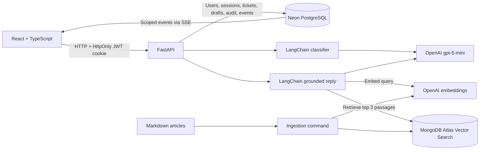

# QuickDesk

QuickDesk is an internal helpdesk where employees submit requests and support agents resolve them. OpenAI suggests categories and priorities, while a LangChain RAG pipeline retrieves company knowledge-base passages from MongoDB Atlas to draft cited replies. Agents review and edit every reply before sending it. Original AI drafts, final replies, and category/priority overrides are retained separately.

## Run locally

Requirements: Python 3.11+ (tested on 3.13), Node.js 22.12+ or compatible newer release (tested on 26), a PostgreSQL database, MongoDB Atlas with Vector Search, and an OpenAI API key with model access and quota. Commands below use PowerShell from the repository root.

```powershell
python -m venv backend/.venv
backend/.venv/Scripts/python.exe -m pip install -r backend/requirements.lock.txt
Copy-Item backend/.env.example backend/.env
```

Skip the copy if your `.env` already exists. Configure:

| Variable | Purpose |
| --- | --- |
| `DATABASE_URL` | Neon connection URL, retaining TLS parameters; `postgresql://` is accepted and mapped to psycopg |
| `JWT_SECRET` | At least 32 random characters; generate with `python -c "import secrets; print(secrets.token_urlsafe(48))"` |
| `SEED_PASSWORD` | At least 12 characters for the three sample users; choose a unique local demo password |
| `MONGODB_URI` | Atlas connection string with an authorized database user and network access |
| `MONGODB_DATABASE` | Exact, case-sensitive existing database name; this workspace uses `QuickDesk` |
| `MONGODB_COLLECTION` | `knowledge_chunks` |
| `MONGODB_VECTOR_INDEX` | `knowledge_vector_index` |
| `LLM_PROVIDER` / `LLM_MODEL` | `openai` / `gpt-5-mini` |
| `LLM_API_KEY` | OpenAI generation key |
| `EMBEDDING_MODEL` | `text-embedding-3-small` |
| `EMBEDDING_API_KEY` | OpenAI embeddings key; may be the same as `LLM_API_KEY` |
| `RAG_MIN_SCORE` | Optional Atlas similarity threshold; default `0.65` |
| `FRONTEND_ORIGIN` | `http://localhost:5173`; the same-port `127.0.0.1` alias is also accepted in development |
| `APP_ENV` | `development`; `production` enables Secure session cookies |

Environment files, virtual environments, build output, and local credentials are ignored by Git. Never put API keys in frontend variables.

For **local PostgreSQL instead of Neon**, copy the root `.env.example` to `.env`, set `POSTGRES_PASSWORD`, and use the same password in `DATABASE_URL` (URL-encode special characters). Start Docker Desktop, then run `docker compose up -d postgres`. Docker is not required with Neon. Compose provides only PostgreSQL, not the whole application.

Initialize the application and knowledge base:

```powershell
cd backend
.venv/Scripts/python.exe -m alembic upgrade head
.venv/Scripts/python.exe -m app.seed
.venv/Scripts/python.exe -m app.ingest
.venv/Scripts/python.exe -m uvicorn app.main:app --reload --host 127.0.0.1 --port 8000
```

In a second terminal:

```powershell
cd frontend
npm ci
npm run dev -- --host 127.0.0.1
```

Open [QuickDesk](http://127.0.0.1:5173) and [API documentation](http://127.0.0.1:8000/docs).

| Seed account | Role |
| --- | --- |
| `agent@quickdesk.test` | Agent |
| `employee@quickdesk.test` | Employee |
| `employee2@quickdesk.test` | Second employee for isolation checks |

All seeded accounts initially use `SEED_PASSWORD` from your backend environment. Rerunning the seed command preserves existing users and passwords. There is no public registration or password-reset flow in this assessment scope.

Ingestion writes six fictional sample articles, embeds changed chunks, and requests a Vector Search index if missing. Wait until Atlas reports the index is queryable. It must index `embedding` with 1536 dimensions and cosine similarity, plus a filter field named `embedding_model`. Existing indexes are preserved; model/index changes require an intentional migration. Atlas database users need write and search-index-management permissions for ingestion. Normal serving needs vector search/read access.

## Architecture



PostgreSQL is the system of record; MongoDB stores only knowledge chunks and vectors. Sending a reply and writing the resolution event happen in one transaction. A row lock prevents a second agent from overwriting a resolved ticket. The agent API returns draft history and audit events; employee responses exclude internal drafts and audit details.

## API endpoints

All paths are under `/api`. Mutations after login require the `X-CSRF-Token` returned by login or `/auth/me`.

| Method | Path | Purpose | Access |
| --- | --- | --- | --- |
| GET | `/health` | Process liveness, not dependency readiness | Public |
| POST | `/auth/login` | Sign in; set JWT cookie; return user and CSRF token | Public; origin checked |
| GET | `/auth/me` | Current user and CSRF token | Signed in |
| POST | `/auth/logout` | Revoke server session and clear cookie | Signed in |
| GET | `/tickets` | Search title; filter status/category/priority; 20-row pages | Employee's own or all for agents |
| POST | `/tickets` | Classify and create a ticket | Employee |
| GET | `/tickets/{id}` | Ticket details and final reply | Owner or agent |
| PATCH | `/tickets/{id}` | Update category/priority and audit changes | Agent |
| POST | `/tickets/{id}/drafts` | Retrieve articles and save an immutable AI draft | Agent |
| POST | `/tickets/{id}/reply` | Store final reply and resolve atomically | Agent |
| GET | `/metrics` | Counts, median resolution time, category override rate | Agent |
| GET | `/events` | Authenticated, role-scoped SSE notifications | Signed in |

## Decisions and tradeoffs

- **React over Next.js:** this is an authenticated dashboard with a separate required Python backend. Vite supplies the development proxy and build; server rendering adds little for this use case. React Query owns API data and invalidation; local component state owns unsent replies. Styling uses Tailwind's Vite integration and custom CSS, without a helpdesk template.
- **RAG:** LangChain's recursive character splitter uses 1200-character chunks and 200-character overlap. The six short articles currently produce six chunks. OpenAI `text-embedding-3-small` returns 1536 dimensions. Atlas retrieves the top three results, prefiltered by embedding model, with an initial `0.65` score cutoff. This threshold is a heuristic, not a calibrated confidence score. The structured draft must report whether the sources support an answer and cite retrieved filenames. Invalid citations fail closed. A no-match or unsupported answer produces a clear no-guidance draft; a service failure leaves manual replying available.
- **AI classification:** allowed category and priority values are enforced by a Pydantic structured-output schema. The provider client permits one retry for retryable transport/provider failures. Invalid structured output or exhausted retries results in a stored ticket with Other/Medium defaults, a `failed` classification state, and no falsely attributed AI suggestion. The original suggestion is immutable when an agent overrides the current values.
- **JWT storage:** an eight-hour JWT is stored in an HttpOnly, SameSite=Strict cookie scoped to `/api`. A signed CSRF claim must match the mutation header, and supplied Origin headers must match configured origins. The frontend holds only the CSRF token in memory. Database-backed session IDs allow immediate logout revocation. Production requires HTTPS, Secure cookies, and a same-site frontend/API proxy.
- **Backend permissions:** the user and role are loaded from the database for each authenticated request. Employees cannot access agent endpoints or another employee's tickets by guessing IDs. Agent creation is restricted to the local seed/admin process. Passwords are Argon2 hashes.
- **SSE:** the required updates flow from server to browser, so submissions and replies use HTTP and notifications use SSE. Persisted events are polled every two seconds and filtered by owner/role. Reconnect emits `ready`, which refetches authoritative state. Every 15 seconds the stream also requests reconciliation to handle concurrent event commits. Streams expire with the JWT and check revocation during polling. This is simple and works across processes, but costs one database query per stream every two seconds.
- **Metrics:** counts use current status/category. Median resolution time is calculated from creation to resolution across resolved tickets. Category override percentage is distinct tickets with any category change divided by tickets with a valid original AI category. Each ticket is counted once even after repeated changes or a reversal.
- **Worst current failure mode:** external AI outages or long responses delay ticket submission (classification is synchronous). Errors preserve the ticket with clearly labeled defaults. A durable background queue would reduce latency, enable controlled retries, and avoid client-timeout duplicate submissions. Human review is still necessary: source validation does not prove every sentence in a draft is supported.
- **AI assistance disclosure:** Codex generated implementation and tests and helped diagnose Atlas database-name capitalization, reasoning-model output budgets, and a frontend session-cache bug caught during browser testing. These are actual development observations, not a claim of independent human authorship. Review and personalize this section before submitting the assessment.

## Verification

```powershell
# From backend: isolated SQLite tests, mocked AI, no external writes
.venv/Scripts/python.exe -m unittest discover -s tests -v
# Read-only database connectivity
.venv/Scripts/python.exe -m app.check_services
# Also makes two small, billable synthetic OpenAI calls
.venv/Scripts/python.exe -m app.check_services --openai
# Optional live workflow: creates a labeled demo ticket and resolves it
.venv/Scripts/python.exe -m app.smoke
# Optional live SSE check: creates and resolves a second labeled demo ticket
.venv/Scripts/python.exe -m app.smoke_events
# From frontend
npm run build
```

The eight isolated tests cover authentication, CSRF, revocation, role/ownership checks, validation and filters, audit events, immutable drafts, duplicate resolution, AI failure fallback, event scoping, and citation rejection. A live Neon/Atlas/OpenAI workflow was verified with a VPN ticket classified IT/Medium and a draft citing two articles. Live SSE checks confirmed both employee and agent sessions received creation and resolution events. An unrelated recipe query returned the no-guidance fallback. SQLite tests do not prove PostgreSQL lock behavior under simultaneous load.

## Known limitations and more time

- No login or AI-call rate limiting, production monitoring, or background job queue. Deploy behind appropriate controls before broader use.
- Six fictional articles are demonstration content, not real company policy. Attachments store filenames only.
- No ticket reopening, follow-up thread, public registration, email delivery, or actual upload handling.
- SSE polling and Python-side median calculation suit a small assessment dataset. At scale, use a shared event broker, periodic event/session cleanup, and database-side percentile aggregation.
- RAG is explicitly retrieved and grounded, but cannot guarantee hallucination-free output. Add a larger retrieval evaluation set and policy-specific review checks before real use.
- Ingestion is idempotent for unchanged chunks and removes obsolete chunks for present articles. Removing an article file entirely requires a deliberate cleanup of its old records.
- Production hosting, a public GitHub repository, and the demo recording remain separate submission steps. No deployment was performed.

## Demo outline (3–5 minutes)

1. Sign in as an employee, submit a VPN request, and show the stored AI category/priority.
2. In a separate browser profile, show the new ticket appearing in the agent queue without refreshing.
3. Open the ticket, generate a draft, expand its sources, override priority, and show the audit entry.
4. Copy the draft into the editor, edit it, and send. Show the employee's live resolved status and final reply.
5. Show the retained original draft and metrics, then explain the architecture and one concrete limitation.
